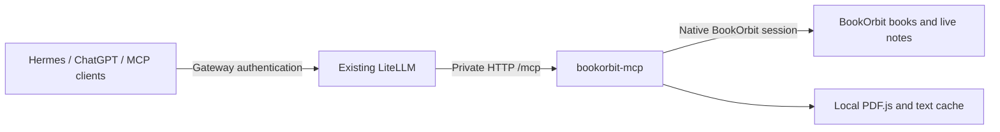

# bookorbit-mcp

An [MCP](https://modelcontextprotocol.io) server that exposes the **text of your
ebooks** — managed by [BookOrbit](https://github.com/bookorbit/bookorbit) — to
LLMs, so an assistant can answer questions about _what happens inside a book_
without you copy-pasting chapters.

It is deliberately **navigation-first**: instead of dumping a whole 100k-word
book into the model's context (which would overwhelm it), the server lets the
model find a book, look at its chapter list, and pull only the pieces it needs.

## How it works



| Capability     | Before                   | Now                                                          |
| -------------- | ------------------------ | ------------------------------------------------------------ |
| Text           | EPUB chapters            | EPUB + PDF chapters/pages; whole-book text with continuation |
| Original book  | Not exposed              | Explicit EPUB/PDF file fetch as an embedded MCP resource     |
| Authentication | Password or static token | Also native BookOrbit SSO enrollment and durable refresh     |
| Transport      | stdio                    | Also stateless Streamable HTTP behind an existing gateway    |
| Notes          | Live BookOrbit reads     | Same live reads; no export or extra index                    |

EPUB text uses BookOrbit's reader API; PDF text uses PDF.js locally. Cached text
is isolated by origin/account and source file revision. Every read checks current
BookOrbit access, including cache hits. Annotations are always fetched live.

Three guardrails keep the model from drowning:

1. **Structure before text** — `list_chapters` returns chapter labels and sizes,
   never the body.
2. **Bounded, paginated text** — `get_chapter` caps output (~24k chars) and pages
   through long chapters with `offset` / `nextOffset`.
3. **Snippet-only search** — `search_in_book` returns short snippets plus a
   chapter index + offset the model can re-fetch precisely.

## Tools

All tools are **read-only**.

**Find & read book text**

| Tool                                                         | What it does                                                                             |
| ------------------------------------------------------------ | ---------------------------------------------------------------------------------------- |
| `search_books(query, limit?)`                                | Find books by title/author/series; returns `bookId` + formats + `hasEpub`.               |
| `get_book_text(bookId, fileId?, offset?, maxChars?)`         | Complete text in order, with explicit continuation.                                      |
| `get_book_file(bookId, fileId)`                              | Original EPUB/PDF as an embedded MCP resource, up to 20 MiB.                             |
| `get_book(bookId)`                                           | Full metadata (description, series, genres, files).                                      |
| `list_chapters(bookId)`                                      | Chapter list with per-chapter char/word counts (no text). Parses + caches on first call. |
| `get_chapter(bookId, chapter, offset?, maxChars?)`           | Plain text of one chapter, paginated.                                                    |
| `search_in_book(bookId, query, maxResults?, caseSensitive?)` | Keyword search within a book → snippets + locations.                                     |

**Discovery & browse**

| Tool                                                                    | What it does                                                                                                       |
| ----------------------------------------------------------------------- | ------------------------------------------------------------------------------------------------------------------ |
| `get_related_books(bookId, kind)`                                       | `similar` / `same_series` / `same_author` books for a book.                                                        |
| `list_series(page?, size?)`                                             | Library's series with book/read counts.                                                                            |
| `get_series_books(seriesId, page?, size?)`                              | Books in a series, in order.                                                                                       |
| `list_authors(page?, size?)`                                            | Library's authors with book counts.                                                                                |
| `get_author(authorId)`                                                  | One author, including their bio.                                                                                   |
| `get_author_books(authorId, page?, size?)`                              | Books by an author.                                                                                                |
| `list_collections()` / `get_collection(id)` / `get_collection_books(…)` | User collections, one collection's detail, and its books.                                                          |
| `list_smart_scopes()` / `get_smart_scope_books(…)`                      | Saved dynamic filters and the books they match.                                                                    |
| `list_libraries()`                                                      | Libraries with per-library book/size/format stats.                                                                 |
| `suggest_metadata(kind, q)`                                             | Typeahead over authors/series/genres/tags/publishers/languages/narrators/collections — resolve an exact name.      |
| `get_book_shelf(type, limit?)`                                          | A curated shelf: recently-added, want-to-read, up-next-in-series, continue-reading/listening, random, smart-scope. |
| `search_author_metadata(q, …)`                                          | External provider author-bio candidates (enrichment, not your library).                                            |

**Reading state & stats**

| Tool                                       | What it does                                                                                            |
| ------------------------------------------ | ------------------------------------------------------------------------------------------------------- |
| `get_reading_progress(bookId)`             | Per-file progress (+ audiobook progress) for a book.                                                    |
| `list_currently_reading()`                 | Books you're reading now, with progress.                                                                |
| `get_reading_sessions(bookId, page?, …)`   | Reading-session history + aggregate stats for a book.                                                   |
| `get_library_stats()`                      | Library-wide totals (books/authors/series/storage/…).                                                   |
| `get_reading_stats()`                      | Your personal reading totals (started/completed/…).                                                     |
| `get_library_statistic(kind, libraryIds?)` | One library-wide chart: distributions, top-authors/series, timelines, metadata-health gauges.           |
| `get_reading_statistic(kind, days?, …)`    | One personal reading chart: peak-hours, favorite-days, heatmap, completion-latency, goal-trajectory, …  |
| `get_dashboard_widget(kind)`               | One "headline card": reading-streak, reading-goal, year-projection, neglected-gems, library-overview, … |

**Annotations** (your own highlights & notes)

| Tool                                          | What it does                                        |
| --------------------------------------------- | --------------------------------------------------- |
| `list_annotations(page?, pageSize?, bookId?)` | All highlights/notes across the library, paginated. |
| `list_annotated_books()`                      | Which books have annotations, with counts.          |
| `get_annotations(bookId)`                     | One book's highlights/notes, in chapter order.      |

**Images** (returned as image content, not text)

| Tool                                | What it does                                  |
| ----------------------------------- | --------------------------------------------- |
| `get_book_cover(bookId, size?)`     | A book's cover image (`full` or `thumbnail`). |
| `get_author_image(authorId, size?)` | An author's photo (`full` or `thumbnail`).    |

**Typical flow:** `search_books` → `list_chapters` → `get_chapter` /
`search_in_book`.

## Requirements & scope

| Requirement   | Behavior                                                                                                             |
| ------------- | -------------------------------------------------------------------------------------------------------------------- |
| Runtime       | Node.js >=22.13; locked dependencies installed in a persistent checkout                                              |
| EPUB          | BookOrbit reader API; multiple EPUB editions require original-file fetch because the reader API selects by book ID   |
| PDF           | Embedded text, outlines and 1-based page ranges; without an outline, sections are pages                              |
| Scanned pages | Reported in `requiresOcrPages`; this server does not perform OCR                                                     |
| Limits        | Downloads up to 20 MiB; PDFs up to 2,000 pages / 10 million extracted characters; one cold-book extraction at a time |
| Identity      | One configured BookOrbit account per process; all authorized gateway clients use that account                        |
| SSO           | BookOrbit 3.7 native OIDC APIs; see [gateway and SSO setup](docs/gateway.md)                                         |
| Existing data | Books, notes and reading state stay in BookOrbit; no writes or migrations                                            |

The original-file resource URI is an identifier, not a public download link.
Clients without embedded binary resource support can use `get_book_text`.
PDF text order follows PDF.js extraction and may differ from visual layout in
complex columns/tables. Blank pages and image-only pages are both flagged as
potential OCR candidates. Embeddings are not required; existing semantic indexes
can remain separate.

## Configuration

Set these as environment variables (or in a local `.env` — see `.env.example`):

| Variable                                    | Required          | Notes                                                                 |
| ------------------------------------------- | ----------------- | --------------------------------------------------------------------- |
| `BOOKORBIT_URL`                             | yes               | BookOrbit base URL, without credentials/query/fragment                |
| `BOOKORBIT_SESSION_FILE`                    | SSO mode          | Private native-session file; do not also set password/token variables |
| `BOOKORBIT_USERNAME` + `BOOKORBIT_PASSWORD` | password mode     | Existing login and refresh behavior                                   |
| `BOOKORBIT_TOKEN`                           | token mode        | Static access token; does not auto-refresh                            |
| `CACHE_DIR`                                 | optional          | Default `~/.cache/bookorbit-mcp`; keep private                        |
| `MCP_TRANSPORT`                             | optional          | `stdio` (default) or `http`                                           |
| `MCP_HOST` / `MCP_PORT`                     | optional          | Default `127.0.0.1:3000`                                              |
| `MCP_ALLOWED_HOSTS`                         | non-loopback HTTP | Comma-separated exact Host header values, including non-default ports |
| `SSO_PROVIDER`                              | enrollment only   | Enabled BookOrbit provider slug; optional if exactly one exists       |
| `SSO_REDIRECT_URI`                          | enrollment only   | Existing BookOrbit HTTPS origin + `/oauth2-callback?bookorbit_mcp=1`  |

HTTP is private gateway-to-connector transport, not a public authenticated API.
Restrict it to the gateway with the existing network-policy/firewall owner.
[Detailed deployment and native SSO enrollment](docs/gateway.md).

## Install & build

```bash
npm ci
npm run build
```

## Use with a Claude client

Add to your MCP client config (e.g. Claude Desktop's `claude_desktop_config.json`,
or `claude mcp add`). Point at the built entry and pass your credentials:

```json
{
  "mcpServers": {
    "bookorbit": {
      "command": "node",
      "args": ["/absolute/path/to/bookorbit-mcp/dist/server.js"],
      "env": {
        "BOOKORBIT_URL": "https://bookorbit.example.com",
        "BOOKORBIT_USERNAME": "your-username",
        "BOOKORBIT_PASSWORD": "your-password"
      }
    }
  }
}
```

## Development

| Documentation preview         | Command                                                                                                                  |
| ----------------------------- | ------------------------------------------------------------------------------------------------------------------------ |
| Install the declared renderer | `mise install`                                                                                                           |
| Render README diagrams        | `mise run docs-render` (uses Puppeteer's configured browser; `PUPPETEER_EXECUTABLE_PATH` can select an installed Chrome) |

```bash
npm test          # unit tests (offline; run against captured fixtures)
npm run typecheck # type-check only
npm run dev       # run the server from source over stdio

# Live checks against a real server (need .env with credentials):
node --import tsx scripts/smoke.mts      # exercises search → parse → chapter → search
node --import tsx scripts/mcp-check.mts   # drives the built server over the MCP stdio protocol
```

## Design notes

- **Chapters follow the TOC, not raw files.** A single EPUB spine file can bundle
  many chapters separated by `#fragment` anchors; the server resolves the table
  of contents into meaningful sections and slices each one by its anchor range.
- **Cache layout:** `~/.cache/bookorbit-mcp/<bookId>/book.json` (chapter list +
  sizes) and `text/section-NNN.txt` (extracted text per chapter).
- **Discovery, reading-state, stats, and annotation tools are live passthroughs**
  to BookOrbit and are **not cached** (that data is mutable); only extracted EPUB
  text is cached.
- **Not included (v1):** semantic/RAG search, cross-library content search,
  PDF/MOBI, and any write operations. The cache layout leaves room to add a
  cross-book index later.
